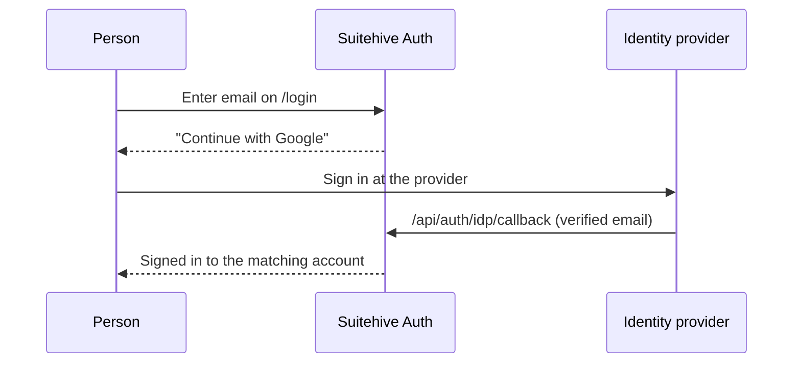

import { Steps, Aside } from '@astrojs/starlight/components';

**What you'll learn:** how external sign-in (OIDC federation) works, what you can configure, its limits, and where Suitehive acts as an OpenID Connect provider itself.

## How it works

You register an identity provider (IdP) such as Google Workspace or Microsoft Entra ID. On the sign-in page, after a person enters their email, Suitehive shows a **Continue with Google** (or the provider's name) button for each provider that is enabled and allowed for their organization.



Suitehive matches the provider's **verified email** to an existing account. It never creates accounts:

- The email must belong to an existing, active, unlocked user of your organization, on one of your verified domains.
- The provider must report the email as verified.
- **Organization owners can't use external sign-in.** They always sign in with their password, so an IdP outage can't lock you out.

External sign-in doesn't ask for Suitehive's own 2-step code, but people who must use 2-step under your [security policies](/docs/admin/security-policies/) still have to enroll it.

## Provider settings

| Field | Description |
|---|---|
| Kind | `google`, `microsoft` or `oidc` (any OpenID Connect provider) |
| Slug | Short identifier. Defaults to the kind for Google and Microsoft. Can't be changed later. |
| Display name | Button label, up to 80 characters. Defaults to "Google" or "Microsoft". |
| Issuer | The provider's issuer URL. Must be `https`. Endpoints are found through OpenID Connect discovery. |
| Client ID, client secret | From the app you register at the provider. The secret is stored encrypted and never shown again. |
| Scopes | Extra scopes. `openid email profile` are always requested. |
| Enabled | On or off |

Rules for the common providers:

- **Google:** the issuer is always `https://accounts.google.com`.
- **Microsoft:** use your tenant's issuer, `https://login.microsoftonline.com/<tenant>/v2.0`. The shared `common`, `organizations` and `consumers` endpoints are rejected.

An organization can have up to 20 providers. Sign-in uses the authorization code flow with PKCE and a nonce.

## Set up a provider

<Aside type="caution" title="No provider screen in the console yet">
The admin console doesn't have an identity-providers page yet. You create providers through the Auth API (`POST /api/admin/idps`; see the [Auth API reference](/docs/api/auth/)). Creating, changing and deleting providers needs the organization owner and a recent 2-step confirmation. The console only has the **Sign in with** Google and Microsoft switches.
</Aside>

<Steps>
1. At your provider, register a web application. Use this redirect (callback) URL:

   ```text
   https://suite.example.com/api/auth/idp/callback
   ```

   Replace the host with your `SH_PUBLIC_URL`. The API also returns it as `redirectUri` for each provider.
2. Create the provider in Suitehive with the client ID and secret, and enable it.
3. Allow it for the organization. In **Admin › Access › Security policies**, turn on **Sign in with Google** or **Microsoft**. A custom `oidc` provider is allowed by adding its slug to the policy's allowed providers through `PATCH /api/admin/org/policy`.
4. Sign out and try it with a non-owner account.
</Steps>

A provider is offered only when it is **enabled** and its slug is **allowed** by the policy.

## Limits today

- No automatic account creation: people must already exist in Suitehive.
- No "allowed domains" setting per provider; matching is by verified email on your verified domains.
- Accounts aren't permanently linked to a provider identity; each sign-in matches by email.
- If sign-in at the provider fails, the person returns to `/login`, but the page doesn't show an error message yet.

## Suitehive as an OpenID Connect provider

Suitehive Auth is also an OpenID Connect provider: Mail and Calendar sign in through it. It serves `/.well-known/openid-configuration`, `/jwks`, `/oauth2/authorize`, `/oauth2/token`, `/oauth2/userinfo`, `/oauth2/introspect`, `/oauth2/revoke` and `/oauth2/end_session`, with the authorization code flow plus PKCE for apps and client credentials for services. People see and revoke apps they've approved under **Account › Connected apps**.

<Aside type="note" title="Not available yet: registering your own apps">
There is no admin screen or API yet to register other applications for "Sign in with Suitehive". Today only the built-in Mail and Calendar clients are registered.
</Aside>

## Next steps

- [Security policies](/docs/admin/security-policies/)
- [Users](/docs/admin/users/)
