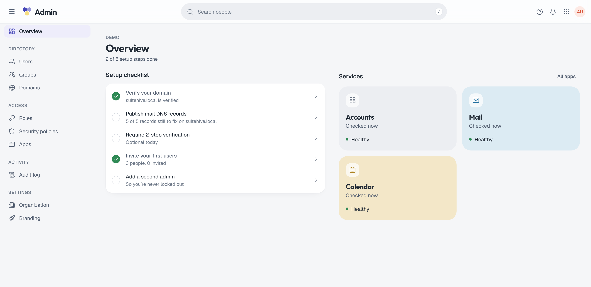

import { Aside, CardGrid, LinkCard } from '@astrojs/starlight/components';

**What you'll learn:** who can use the admin console, how it is organized, and which admin features are built today.

The admin console is part of Auth, the shared sign-in service. Open it at `https://<your hostname>/admin`. The first admin created by `suitehive install` is the organization **owner**.

## Who can open it

People with one of the built-in admin roles can open the console: `owner`, `admin`, `user_admin` or `helpdesk`. Everyone else sees "You don't have access to the admin console." Each action is then checked against the person's permissions on the server, so a `helpdesk` admin sees the pages but can only do what the role allows. See [Roles and permissions](/docs/admin/roles/).

<Aside type="note">
People who hold only a custom role can't open the console yet, even if the role grants admin permissions. Their permissions still work through the API.
</Aside>

## Layout

| Section | Page | Path | What it's for |
|---|---|---|---|
| | **Overview** | `/admin` | Service status and a summary of your organization |
| Directory | **Users** | `/admin/users` | Invite, suspend and delete people |
| | **Groups** | `/admin/groups` | Teams and mailing-list addresses |
| | **Domains** | `/admin/domains` | Prove domain ownership and set up mail DNS |
| Access | **Roles** | `/admin/roles` | Built-in and custom admin roles |
| | **Security policies** | `/admin/security` | 2-step, passwords, sessions, app passwords |
| | **Apps** | `/admin/apps` | Installed apps and their health |
| Activity | **Audit log** | `/admin/audit` | Who did what, and when |
| Settings | **Organization** | `/admin/settings/organization` | Organization name and short name |
| | **Branding** | `/admin/settings/branding` | Organization logo (SVG or PNG, up to 1 MB), shown on sign-in |

The users, groups, domains, roles and audit lists have right-click menus on their rows with the same actions as the row's `…` menu. On the Users page, press `n` to add a user.

## Built today and not yet

| Area | State |
|---|---|
| Users, groups, domains, roles, security policies, audit log, app health | Available in the console |
| Mail aliases, changing a primary address, changing a group's email | API only |
| External sign-in providers (Google, Microsoft, OIDC) | API, plus on/off switches in Security policies |
| Mail settings (DKIM keys, outbound queue, smarthost routing) | Mail API only; the console section is not available yet |
| Calendar settings (rooms, sharing defaults) | Not available yet |
| Bulk import (CSV), audit log export | Not available yet |

<Aside type="caution" title="Early development">
Suitehive isn't production-ready. Admin screens and APIs can still change before v1.
</Aside>

## Admin pages

<CardGrid>
  <LinkCard title="Users" href="/docs/admin/users/" description="Invite, suspend and delete people." />
  <LinkCard title="Groups" href="/docs/admin/groups/" description="Teams and group addresses." />
  <LinkCard title="Domains" href="/docs/admin/domains/" description="Verification, DNS checklist and DKIM." />
  <LinkCard title="Roles and permissions" href="/docs/admin/roles/" description="Who can do what." />
  <LinkCard title="Security policies" href="/docs/admin/security-policies/" description="2-step, passwords and sessions." />
  <LinkCard title="External sign-in" href="/docs/admin/external-sign-in/" description="Google, Microsoft and OIDC providers." />
  <LinkCard title="Audit log" href="/docs/admin/audit-log/" description="Every sign-in and change." />
  <LinkCard title="Services health" href="/docs/admin/services-health/" description="Is everything running?" />
</CardGrid>

## Next steps

- [Users](/docs/admin/users/)
- [Domains](/docs/admin/domains/)
