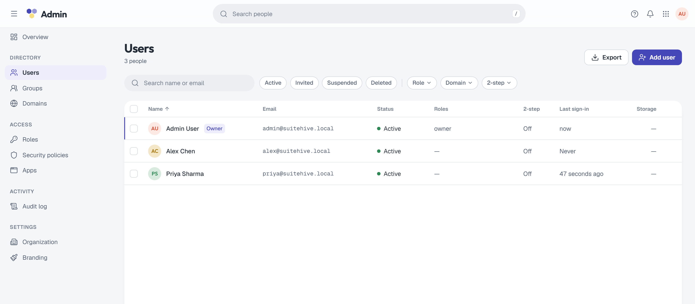
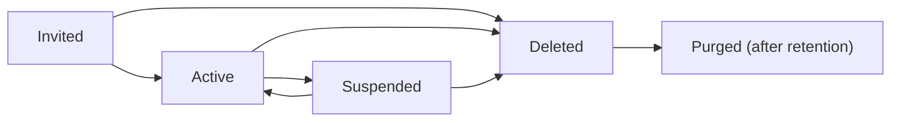

import { Steps, Aside } from '@astrojs/starlight/components';

**What you'll learn:** how to add people, what suspending and deleting really do, and how to help someone who is locked out.

Open **Admin › Directory › Users** (`/admin/users`). Filter by status, role, domain and 2-step, search by name or email, and select rows for bulk actions.

## Account states

| State | Can sign in | Notes |
|---|---|---|
| **Invited** | No | Waiting for them to accept the invitation |
| **Active** | Yes | |
| **Suspended** | No | Data kept. Can be reactivated. |
| **Deleted** | No | Can't be restored. Data is removed after the retention period. |

## Invite a user

You need at least one [verified domain](/docs/admin/domains/) first. Suitehive doesn't create accounts with a password set by an admin: everyone sets their own through an invitation.

<Steps>
1. Click **Add user** (or press `n`).
2. Fill in **Name** and the new **Email** address: the part before the `@`, and a verified domain.
3. In **Send the invite to**, enter an address the person can read today (their personal or current work email).
4. Optionally tick **Roles** and **Groups**.
5. Click **Send invite**.
</Steps>

The invitation email ("You're invited to `<organization>`") links to `/invite/<token>`. The link works once and expires after **7 days**. To send a new one, use **Resend invitation** from the user's menu; the old link stops working. To withdraw an invitation, delete the invited user.

<Aside type="caution" title="Invitation email needs working SMTP">
Auth sends invitations through `SH_EMAIL_SMTP_URL`. On a fresh install this may not deliver yet; see [Troubleshooting](/docs/self-hosting/troubleshooting/#invitation-and-password-reset-emails-dont-arrive).
</Aside>

## User actions

Right-click a row, use its `…` menu, or open the user and use **User actions**:

| Action | What it does |
|---|---|
| **Open** | The user's page: Profile, Security, Groups, Roles, Apps and Activity tabs |
| **Copy email** | Copies their address |
| **Resend invitation** | Invited users only: new 7-day link |
| **Reset password** | Emails a reset link to their Suitehive address. Their current password keeps working until they choose a new one. Active users only. |
| **Reset 2-step** | Removes their passkeys, authenticator app and recovery codes and signs them out everywhere. They set up 2-step again at next sign-in. |
| **Assign role**, **Add to group** | Shortcuts to roles and groups |
| **Suspend** / **Reactivate** | See below |
| **Delete…** | See below |

With several rows selected, the bulk bar offers **Suspend**, **Reset 2-step**, **Assign role** and **Export CSV** (columns: Name, Email, Status, Roles, 2-step, Last sign-in, Storage, Created). There is no CSV import yet.

<Aside type="caution" title="Known issue: reset links">
Password-reset emails (from an admin or from **Forgot password?**) currently link to `/reset-password?token=<token>`, which the web app doesn't serve. The page that works is `/login/reset/<token>`. Until this is fixed, the person can open `https://<your hostname>/login/reset/` followed by the token from the email.
</Aside>

## Suspend and reactivate

Suspending requires a **Reason**, which is shown in the audit log and to other admins. In one step it:

- blocks sign-in;
- signs them out everywhere;
- revokes all their app passwords and personal access tokens.

Their data stays. Mail sent to them follows the **Mail to suspended people** [security policy](/docs/admin/security-policies/):

- **Keep receiving it** (default): Mail accepts the message and holds it in the queue instead of delivering it to the mailbox.
- **Bounce it**: the sender gets a permanent error (`550 5.2.1`).

**Reactivate** lets them sign in again and clears any sign-in lockout. Revoked app passwords are not restored; they create new ones.

You can't suspend yourself or the last active owner.

## Delete a user

<Steps>
1. Choose **Delete…** and read the dialog: "They lose access now. Their mail and calendars are kept until `<date>`, then removed for good."
2. Optionally choose who to **Transfer their mail and calendars to**.
3. Type the user's email to confirm, then click **Delete user**.
</Steps>

Deleting immediately signs them out, revokes app passwords and tokens, removes all their role assignments and expires open invitations. Their address and aliases stay reserved during the retention period, which is set by **Keep deleted accounts for** (default 30 days). After it, the account is purged: addresses, group memberships and credentials are removed and the profile is blanked.

<Aside type="danger" title="Delete can't be undone, and purge is incomplete">
There is no undelete. Suspend instead if you might need the account back.

Two parts of deletion aren't finished yet:
- **Transfer** is recorded, but Mail and Calendar don't act on it yet, so no data is moved.
- Purge waits for Mail and Calendar to confirm they removed the user's data. They don't send that confirmation yet, so deleted users are not purged, and after 7 days the audit log records `auth.user.purge_stalled`.
</Aside>

You can't delete yourself or the last owner.

## Profile and addresses

On the **Profile** tab you can change the name, language and time zone. Aliases are listed there but can only be added or removed through the API (`/api/admin/users/{id}/addresses`), which is also how you change a primary address. When a domain is verified, `postmaster@` and `abuse@` are created automatically as aliases of the first owner.

## Next steps

- [Groups](/docs/admin/groups/)
- [Roles and permissions](/docs/admin/roles/)
- [Security policies](/docs/admin/security-policies/)
