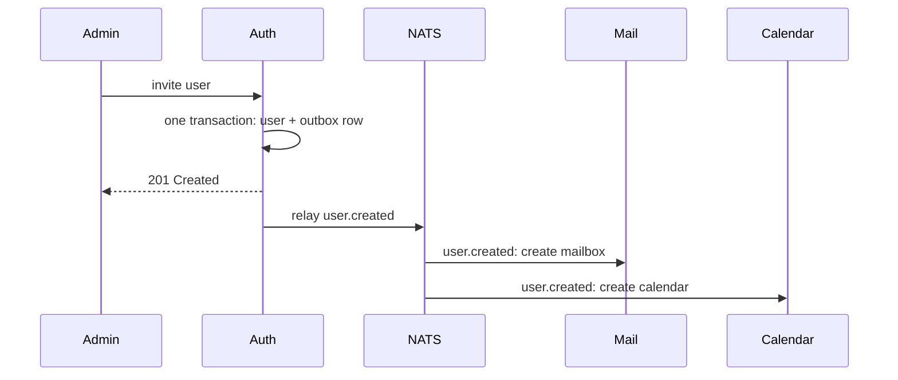

**What you'll learn:** how the apps keep each other up to date, and why no event is lost or applied twice.

## What events are for

Most communication between Suitehive apps is by events. When an admin invites a user, Auth stores the user and announces `user.created`. Mail reacts by creating a mailbox, and Calendar by creating a default calendar. Auth does not need to know either app exists.

## How delivery works

| Stage | What happens | Guarantee |
|---|---|---|
| Outbox | The event is written to the producing service's database in the same transaction as the change | An event exists exactly when the change committed |
| Relay | A background worker sends outbox rows to NATS JetStream, with the event ID as a deduplication key | Nothing is lost if NATS is down; duplicates are dropped |
| Stream | Each service has a stream (`SH_AUTH`, `SH_MAIL`, `SH_CALENDAR`) that keeps events for 14 days | A service that was down catches up |
| Inbox | The consuming service records each event ID in its own database, in the same transaction as its reaction | Each handler applies an event once |
| Retries | Failed handlers are retried with backoff; after 20 failures the event moves to the `SH_DLQ` dead-letter stream | One bad event does not block the rest |

The outbox and inbox together give exactly-once processing, even across crashes and restarts.

## Read-models

Some data is needed on a hot path in another service. Mail must know, for every incoming message, whether the recipient exists. Instead of asking Auth each time, Mail keeps its own copy of the directory, built from Auth's events. If that copy is empty (a fresh database), Mail loads a full snapshot from Auth once. This is why mail keeps arriving when Auth is down.

## Event names

Subjects follow `sh.<service>.<thing>.<event>.v<N>`, for example `sh.auth.user.suspended.v1` or `sh.mail.message.received.v1`. Payloads are protobuf messages defined in the [contracts](/docs/architecture/contracts/) repository. They carry IDs and metadata, never message bodies or passwords.

## Known gaps

- There are no metrics or admin alerts yet for dead-lettered events or consumer lag.

## Next steps

- [Multi-tenancy](/docs/architecture/multi-tenancy/)
- [Events concept (for developers)](/docs/developers/concepts/events/)
