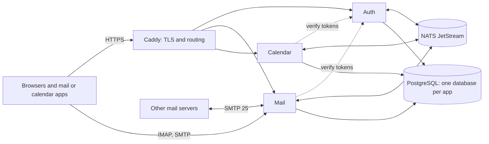

import { Aside } from '@astrojs/starlight/components';

**What you'll learn:** what runs in a Suitehive installation, why it is split the way it is, and how it behaves when a part fails.

<Aside type="caution" title="Early development">
Suitehive is not production-ready. This page describes the design and the parts that are built today; planned parts are marked.
</Aside>

## What runs

| Component | Role |
|---|---|
| **Auth** | The single identity service for every app: organizations, domains, users, groups, roles, sessions, 2-step verification, the OpenID Connect provider, app passwords, the directory, the audit log and the admin console |
| **Mail** | Receives and sends mail (SMTP), serves IMAP and the Mail web app and REST API: threads, labels, search, filters, DKIM, SPF and DMARC checks |
| **Calendar** | Calendars, events, recurrence, invitations, free/busy, rooms, reminders, CalDAV and the Calendar web app |
| **PostgreSQL** | One cluster with a separate database per app |
| **NATS JetStream** | The event bus the apps use to tell each other what happened |
| **Caddy** | The public entry point: HTTPS certificates and routing by path |

Each app is one Go program that can run in several roles (for example Mail: API, inbound SMTP, worker). The installer runs them with Docker Compose on one server. Contacts, Drive and Docs are planned as more apps of the same kind.

## Design decisions

| Decision | Why |
|---|---|
| One repository and one service per app | Apps ship and scale on their own. Any app can be installed with only Auth. |
| One shared Auth service | One sign-in for every app, and one place for users, roles and policies |
| A database per service | No hidden coupling between apps' tables. Each app owns its data. |
| Events for most communication | A new app can react to existing events without changes to the others |
| Tokens checked locally with public keys | No call to Auth on every request, so a slow Auth does not slow down Mail |
| Local copies of shared data ("read-models") | Mail can accept incoming mail even when Auth is down |
| Standard protocols at the edges | SMTP, IMAP, CalDAV and iCalendar work with third-party clients and servers |

## When something is down

| Down | Effect | Why it is limited |
|---|---|---|
| Auth | New sign-ins, token refresh and admin changes fail | Existing access tokens stay valid for up to 10 minutes; Mail and Calendar keep their own copy of the directory; app-password checks are cached briefly |
| NATS | Events are delayed | Each service keeps unsent events in its own database (the outbox) and sends them when NATS is back |
| Mail | Calendar's email invitations are delayed | The sending job retries with backoff |
| Calendar | Replies to invitations wait | The events stay in NATS until Calendar is back |

## Learn more

- [Repositories](/docs/architecture/repositories/)
- [Contracts](/docs/architecture/contracts/)
- [Events](/docs/architecture/events/)
- [Multi-tenancy](/docs/architecture/multi-tenancy/)
- [Security model](/docs/architecture/security/)

## Next steps

- [Security model](/docs/architecture/security/)
- [How Suitehive fits together (for developers)](/docs/developers/how-it-fits/)
