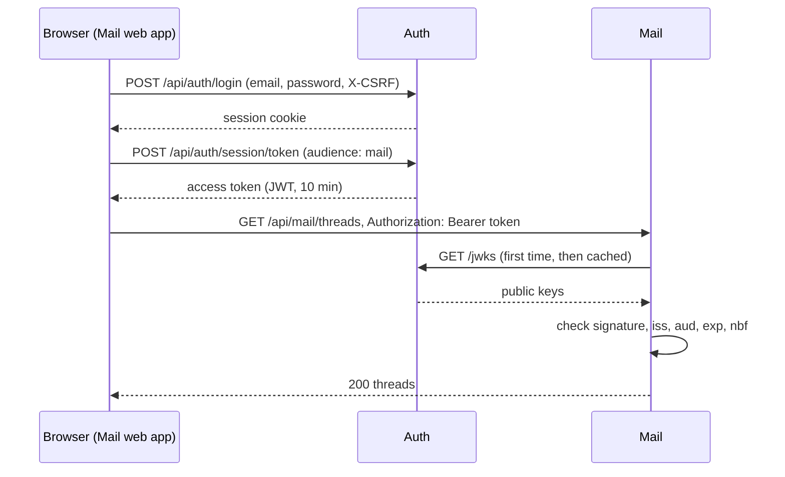

import { Aside } from '@astrojs/starlight/components';

**What you'll learn:** how a signed-in browser gets a token for Mail or Calendar, and how those services check it without calling Auth.

## The short version

- **Auth is the only issuer.** Sign-in, 2-step verification and sessions happen in Auth only.
- **Tokens are short-lived [JWTs](/docs/developers/glossary/#jwt)**, signed with ES256 and valid for 10 minutes.
- **Each token names its [audience](/docs/developers/glossary/#audience)**, for example `mail`. Calendar refuses a token whose audience does not include `calendar`.
- **Services verify tokens locally**, with Auth's public keys from `/jwks` ([JWKS](/docs/developers/glossary/#jwks)). There is no call to Auth per request, so Mail and Calendar keep working for signed-in users for a while if Auth is down.

## From sign-in to an API call



1. The user signs in on the Auth web app. Auth sets an HttpOnly session cookie and a CSRF cookie.
2. The Mail web app (through `@suitehive/auth-client`) exchanges the session for an access token at `POST /api/auth/session/token`. The token lives in memory only, never in `localStorage`.
3. Every API call sends `Authorization: Bearer <token>`. The client fetches a new token shortly before the old one expires.

```ts title="ui/packages/auth-client/src/client.ts"
const res = await doFetch(`${apiBase}/api/auth/session/token`, {
  method: 'POST',
  credentials: 'include',
  headers: {
    'Content-Type': 'application/json',
    Accept: 'application/json',
    'X-CSRF': readCookie('sh_csrf') ?? '1',
  },
  body: JSON.stringify({ audience: options.audience }),
});
```

## What is inside a token

| Claim | Meaning |
|---|---|
| `iss` | The issuer: Auth's public URL (`http://localhost:5171` in local development) |
| `sub` | The user ID, or `svc:<name>` for a service |
| `org` | The user's organization; it becomes the tenant for [RLS](/docs/developers/concepts/multi-tenancy/) |
| `aud` | The services this token is for, such as `["mail"]` |
| `exp`, `iat`, `nbf` | Expiry, issue time, not-before time |
| `sid` | The session ID, used to revoke tokens when the session ends |
| `amr` | How the user signed in (for example password, one-time code) |
| `roles`, `scope` | The user's org roles and the granted scopes |

## How a service verifies a token

`kit/authn.JWKSVerifier` does the work. You configure it with three values:

```go title="kit/authn/jwks.go"
type JWKSConfig struct {
	// Issuer is Auth's issuer URL; the iss claim must equal it. Required.
	Issuer string `env:"ISSUER" yaml:"issuer"`
	// Audience is this service's audience ("mail"); aud must contain it. Required.
	Audience string `env:"AUDIENCE" yaml:"audience"`
	// JWKSURL defaults to Issuer + "/jwks".
	JWKSURL string `env:"JWKS_URL" yaml:"jwks_url"`
	// ...
}
```

In Mail and Calendar these come from `SH_AUTHN_ISSUER`, `SH_AUTHN_AUDIENCE` and `SH_AUTHN_JWKS_URL`. The verifier accepts only ES256, caches the keys, refreshes them every 10 minutes or when it sees an unknown key ID, and allows 60 seconds of clock skew.

**Revocation.** When a session ends or a user is suspended, Auth publishes an event. Each service keeps a small in-memory deny-list fed from those events, so a revoked token stops working within seconds, not 10 minutes.

## Service-to-service calls

Services have their own identity, a [service client](/docs/developers/glossary/#service-client) such as `svc:mail`. They get a token from `POST /oauth2/token` with a client ID and secret (client credentials), and `kit/rpcauth` attaches it to outgoing RPC calls. The receiving service checks it against an allow-list per RPC method.

## Mail and calendar apps (IMAP, SMTP, CalDAV)

These clients cannot do a browser sign-in. They send the email address and an [app password](/docs/developers/glossary/#app-password). Mail or Calendar checks it with Auth's `ProtocolAuth` RPC and caches a successful result for a short time.

<Aside type="caution" title="Issuer must match exactly">
The `iss` claim must equal the configured issuer string. In local development Auth's issuer is `http://localhost:5171`, not `:8081`, so Mail must run with `SH_AUTHN_ISSUER=http://localhost:5171`. A mismatch shows up as `401 common.unauthenticated` on every call.
</Aside>

## Next steps

- [API reference: how to authenticate](/docs/developers/api-reference/#how-to-authenticate)
- [Architecture: security model](/docs/architecture/security/)
- [Events](/docs/developers/concepts/events/)
