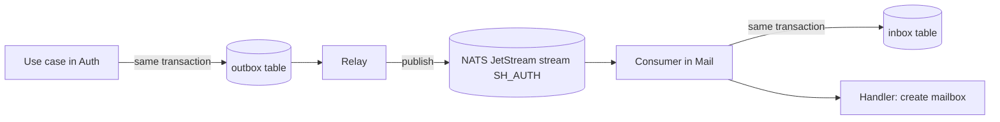

import { Aside } from '@astrojs/starlight/components';

**What you'll learn:** why services use events, how an event travels from one database to another service, and why it is never lost or applied twice.

## Why events

When Auth creates a user, Mail must create a mailbox and Calendar a calendar. Auth could call both, but then Auth would depend on them and fail when they are down. Instead, Auth announces "a user was created", and whoever cares reacts. Adding a new app later means adding a new listener, without changing Auth.

## The path of one event



1. **Outbox.** The use case writes the event into the `outbox` table in the same database transaction as the change. If the transaction rolls back, the event disappears with it. If it commits, the event is safely stored.
2. **Relay.** A background worker reads new outbox rows and publishes them to NATS JetStream. It sets the event ID as the `Nats-Msg-Id` header, so JetStream drops a duplicate if the relay sends the same row twice. Only one replica runs the relay at a time.
3. **Stream.** Each service has a stream (`SH_AUTH`, `SH_MAIL`, `SH_CALENDAR`) that keeps events for 14 days, so a service that was down catches up when it returns.
4. **Inbox.** The consuming service runs each handler in a transaction that first inserts the event ID into its `inbox` table. If the ID is already there, the event was handled before and is skipped. The handler's own writes commit together with that row.
5. **Retries.** If a handler fails, the event comes back after 1 s, 5 s, 30 s, 2 min, then every 10 min. After 20 failed deliveries it moves to the dead-letter stream `SH_DLQ`.

Together, the outbox and the inbox give **exactly-once processing**: every committed change produces its event, and each handler applies it once, even with crashes and retries in between.

## Names and payloads

Subjects follow `sh.<service>.<thing>.<event>.v<N>`:

```go title="contracts/events/subjects.go"
const (
	SubjectMailMessageReceived    = "sh.mail.message.received.v1"
	SubjectMailMessageSent        = "sh.mail.message.sent.v1"
	SubjectMailDeliveryFailed     = "sh.mail.delivery.failed.v1"
	SubjectMailMailboxProvisioned = "sh.mail.mailbox.provisioned.v1"
	// ...
)
```

Payloads are protobuf messages defined in `contracts/proto/suitehive/events/`. They carry IDs and metadata only, never message bodies or passwords:

```protobuf title="contracts/proto/suitehive/events/mail/v1/events.proto"
// sh.mail.message.received.v1 (a message was stored in a local mailbox)
message MessageReceived {
  string org_id = 1;
  string message_id = 2;
  int64 version = 3;
  google.protobuf.Timestamp occurred_at = 4;
  string user_id = 5;
  // ...
  bool has_calendar_part = 10;
}
```

## Who publishes and who listens

| Service | Publishes (examples) | Listens to (examples) |
|---|---|---|
| Auth | `user.created`, `user.suspended`, `domain.verified`, `session.revoked` | other services' `user_data_purged` and audit events |
| Mail | `message.received`, `message.sent`, `mailbox.provisioned` | Auth's user, address, group and domain events |
| Calendar | `event.created` and other event changes | Auth's user and group events; Mail's `message.received` (to read invitation replies) |

<Aside type="note" title="Handlers must be safe to repeat">
The inbox stops the same event from running twice in one handler. Handlers should still compare versions (for example, ignore an update older than what is stored), because events about the same record can arrive out of order.
</Aside>

## Next steps

- [Publish and consume an event](/docs/developers/recipes/events/)
- [Architecture: events](/docs/architecture/events/)
- [Glossary](/docs/developers/glossary/)
