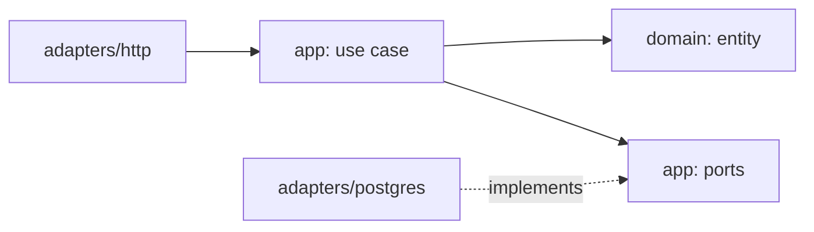

import { Aside } from '@astrojs/starlight/components';

**What you'll learn:** what the `domain`, `app` and `adapters` folders are for, and how one real feature passes through all three.

## Three layers and a wiring file

Every module inside a service (for example `auth/internal/directory`) has the same folders:

| Folder | Holds | May import |
|---|---|---|
| `domain/` | The rules: entities, values, state changes, domain errors | the Go standard library and `kit/kernel` (exceptions are listed in each `ARCHITECTURE.md`) |
| `app/` | Use cases (one struct per action) and the interfaces they need ([ports](/docs/developers/glossary/#port)) | `domain/` |
| `adapters/` | HTTP handlers, Postgres stores, event publishers, RPC clients | `app/`, `domain/`, libraries |
| `module.go` | Builds the adapters and passes them to the use cases | everything in the module |
| `api/` | The small public surface other modules of the same service may use | |

Dependencies point inward: `adapters` know about `app`, `app` knows about `domain`, and `domain` knows about nothing. This keeps the rules testable without a database and lets you swap an adapter without touching a rule.



## One feature, three layers

Here is how an admin suspends a user in Auth (`POST /api/admin/users/{id}:suspend`). The excerpts are shortened.

### 1. The handler parses the request

The HTTP adapter decodes the body, checks its shape and calls one use case. It holds no business rules.

```go title="auth/internal/directory/adapters/http/http.go"
case "suspend":
	exp, err := restapi.IfMatch(r)
	if err != nil {
		restapi.Fail(w, r, err)
		return
	}
	b, err := restapi.Decode[suspendReq](r)
	if err != nil {
		restapi.Fail(w, r, err)
		return
	}
	v, err = h.uc.SuspendUser.Handle(ctx, id, exp, b.Reason)
```

### 2. The use case runs the action

The use case checks permission, opens a transaction, loads the user, asks the domain to change it, saves it and publishes the resulting events, all in one transaction.

```go title="auth/internal/directory/app/lifecycle.go"
func (uc *SuspendUser) Handle(ctx context.Context, id kernel.ID, expected *int64, reason string) (UserView, error) {
	if err := uc.d.Authz.Require(ctx, PermUserSuspend); err != nil {
		return UserView{}, err
	}
	err := uc.d.Tx.WithinTx(ctx, func(ctx context.Context) error {
		owners, err := uc.d.Users.ActiveOwnerCount(ctx)
		// ...
		rec, err := uc.d.Users.GetForUpdate(ctx, id)
		// ...
		u := rec.User
		if err := u.Suspend(uc.d.actor(ctx), reason, owners, uc.d.Clock.Now()); err != nil {
			return err
		}
		if err := uc.d.Users.Update(ctx, u); err != nil {
			return err
		}
		if err := uc.d.publish(ctx, u); err != nil {
			return err
		}
		// ... revoke sessions and app passwords, write the audit record
	})
	// ...
}
```

`uc.d.Users` is a port, declared in `app/ports.go`. The use case does not know it is backed by Postgres:

```go title="auth/internal/directory/app/ports.go"
// UserRepo persists users (tenant-scoped).
type UserRepo interface {
	Get(ctx context.Context, id kernel.ID) (UserRecord, error)
	// GetForUpdate is Get with a row lock.
	GetForUpdate(ctx context.Context, id kernel.ID) (UserRecord, error)
	// Update is version-checked.
	Update(ctx context.Context, u *domain.User) error
	// ...
}
```

### 3. The domain enforces the rules

The entity decides whether the change is allowed and records an event. It does not know about HTTP, SQL or NATS, and it takes the time as a parameter instead of calling `time.Now()`.

```go title="auth/internal/directory/domain/user.go"
func (u *User) Suspend(actor kernel.ID, reason string, activeOwners int, at time.Time) error {
	if u.status != UserActive {
		return ErrUserInvalidTransition
	}
	if actor == u.id {
		return ErrSelfAction
	}
	if err := u.guardOwner(activeOwners); err != nil {
		return err
	}
	_ = u.move(UserSuspended)
	u.statusReason = cleanReason(reason)
	v := u.bump()
	u.record(UserSuspendedEvent{UserID: u.id, OrgID: u.orgID, Reason: u.statusReason, At: at.UTC(), Version: v})
	return nil
}
```

Because the rule lives here, you can test "you cannot suspend yourself" or "you cannot suspend the last owner" with a plain unit test, no database needed.

<Aside type="tip" title="Where to put new code">
Ask what the code knows about. If it knows about HTTP, SQL or a protocol, it is an adapter. If it coordinates a single action, it is a use case. If it is a rule that would hold no matter how you store or expose the data, it belongs in `domain`.
</Aside>

## Next steps

- [Add a REST endpoint](/docs/developers/recipes/rest-endpoint/)
- [Coding principles](/docs/developers/coding-principles/)
- [Multi-tenancy](/docs/developers/concepts/multi-tenancy/)
