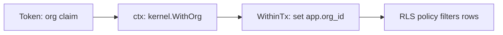

import { Aside } from '@astrojs/starlight/components';

**What you'll learn:** how a query only ever sees the current organization's rows, and what you must do when you add a table.

## In one paragraph

One Suitehive installation can host several organizations ([orgs](/docs/developers/glossary/#org)). Every table that holds an org's data has an `org_id` column. When a request comes in, the org from the caller's token is put into the Go `context`. When the code opens a transaction, `kit/db` copies that org into a Postgres setting called `app.org_id`. Each tenant table has a [Row Level Security](/docs/developers/glossary/#rls) policy that compares `org_id` with that setting, so Postgres itself hides every other org's rows, even if a query forgets a `WHERE org_id = ...`. With no org in the context, the setting is empty and the query sees nothing: it fails closed.



## The code

The transaction runner sets the org for the length of the transaction only (`true` means "local to this transaction"):

```go title="kit/db/tx.go"
if hasOrg {
	st.org = org
	if _, err := tx.Exec(ctx, "SELECT set_config('app.org_id', $1, true)", org.String()); err != nil {
		_ = tx.Rollback(context.WithoutCancel(ctx))
		return nil, fmt.Errorf("db: set tenant: %w", err)
	}
}
```

Every tenant table gets the same policy in its migration:

```sql title="mail/migrations/00004_rules_settings_search.sql"
ALTER TABLE filters ENABLE ROW LEVEL SECURITY;
ALTER TABLE filters FORCE ROW LEVEL SECURITY;
CREATE POLICY tenant_isolation ON filters USING (org_id = NULLIF(current_setting('app.org_id', true), '')::uuid);
```

`kit/db.RLSPolicySQL("filters")` prints the `ENABLE` and `CREATE POLICY` lines for you. `FORCE` makes the policy apply to the table owner too.

<Aside type="caution" title="Why NULLIF">
Use the `NULLIF(..., '')` form, not a bare `current_setting(...)::uuid`. A pooled connection that has already run a tenant transaction reads the setting as an empty string, and casting `''` to `uuid` raises an error instead of hiding rows.
</Aside>

## Two things RLS does not do for you

- **Superusers skip RLS.** Postgres superusers and roles with `BYPASSRLS` see every row. Auth runs its migrations with the login role, then serves requests as a separate role (`SH_DB_ASSUME_ROLE`, default `auth_app`) so the policies apply.
- **Some work must cross orgs.** Signing in by email address, accepting inbound mail before the recipient's org is known, and purge jobs need to see all orgs. They use `db.SystemRunner`, a separate type backed by a `BYPASSRLS` pool, so it cannot be wired into a request handler by accident.

## When you add a table

1. Add an `org_id uuid NOT NULL` column.
2. Enable and force RLS with the `tenant_isolation` policy in the same migration.
3. Write a test that one org cannot read or write another org's rows. Mail's `migrations_test.go` already fails if a new tenant table has no policy.

The [migration recipe](/docs/developers/recipes/migration/) walks through it.

## Next steps

- [Add a migration with RLS](/docs/developers/recipes/migration/)
- [Write a test](/docs/developers/recipes/tests/)
- [Architecture: multi-tenancy](/docs/architecture/multi-tenancy/)
