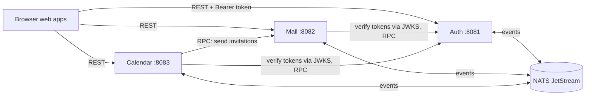

import { Aside } from '@astrojs/starlight/components';

**What you'll learn:** what each part of Suitehive does, how the parts talk, and where to go for the change you want to make.

## The picture

Five ideas explain most of the code:

1. **One service per app.** Auth, Mail and Calendar are separate Go programs in separate repositories. Each has its own Postgres database. No service reads another service's tables.
2. **Auth is the only identity service.** It signs people in and issues short-lived access tokens. Mail and Calendar check those tokens themselves using Auth's public keys (JWKS), so they do not call Auth on every request. See [Auth tokens](/docs/developers/concepts/auth-tokens/).
3. **Services talk through contracts.** The shapes of REST calls, RPC calls and events all live in the [contracts](https://github.com/Suitehive/contracts) repository. A service imports only `kit` and `contracts`, never another service's code.
4. **Events over calls.** When Auth creates a user, it publishes an event. Mail reacts by creating a mailbox, and Calendar by creating a calendar. Events go through an outbox table and NATS JetStream, so none are lost. See [Events](/docs/developers/concepts/events/).
5. **Every row belongs to an organization.** Tenant tables have an `org_id` column, and Postgres Row Level Security hides other organizations' rows. See [Multi-tenancy](/docs/developers/concepts/multi-tenancy/).

Inside a service, code is split into layers: `domain` (rules), `app` (use cases), `adapters` (HTTP, Postgres, NATS). See [Layering](/docs/developers/concepts/layering/).

## I want to change X: where do I go?

All paths are relative to the workspace root.

| I want to... | Go to |
|---|---|
| Add or change a Mail REST endpoint | `contracts/openapi/mail.yaml`, then `mail/internal/webmail/adapters/httpapi/server.go` (route and handler) and `mail/internal/webmail/app/` (use case). Recipe: [Add a REST endpoint](/docs/developers/recipes/rest-endpoint/) |
| Add or change a Calendar REST endpoint | `contracts/openapi/calendar.yaml`, then the module's `adapters/http` folder, for example `calendar/internal/events/adapters/http/handlers.go` |
| Add or change an admin endpoint (users, groups) | `contracts/openapi/auth.yaml`, then `auth/internal/directory/adapters/http/http.go` and `auth/internal/directory/app/` |
| Call a new endpoint from a web app | `<app>/web/src/shared/api/ports.ts` (interface), `http.ts` (live), `mock.ts` (mock data) |
| Add a screen to a web app | `<app>/web/src/app/routes/` (one file per route) and `<app>/web/src/features/`. Recipe: [Add a UI screen](/docs/developers/recipes/ui-screen/) |
| Add or change a shared UI component | `ui/packages/ui/src/components/`, exported from `ui/packages/ui/src/index.ts` |
| Change the top bar, app switcher or command palette | `ui/packages/shell/` |
| Change colors, fonts or themes | `ui/packages/tokens/` |
| Add an event | `contracts/proto/suitehive/events/<service>/v1/events.proto`, `contracts/events/subjects.go` and `registry.go`, then publish through the outbox. Recipe: [Publish and consume an event](/docs/developers/recipes/events/) |
| React to another service's event | A handler like `mail/internal/dkim/adapters/adapters.go` (`DomainVerifiedHandler`), registered in the service's wiring (`mail/cmd/mail/wire_team.go`, `calendar/internal/server/server.go`, `auth/internal/server/server.go`) |
| Add a service-to-service RPC | `contracts/proto/suitehive/<service>/v1/`, then run `./gen.sh` in `contracts/` |
| Add a table or column | `<service>/migrations/` (a new numbered `.sql` file). Recipe: [Add a migration with RLS](/docs/developers/recipes/migration/) |
| Change shared backend plumbing (outbox, auth middleware, transactions) | `kit/` (for example `kit/outbox`, `kit/authn`, `kit/db`) |
| Change how a service starts or reads its settings | `auth/cmd/auth/`, `mail/cmd/mail/`, `calendar/cmd/calendar/` |
| Change the local Postgres or NATS setup | `deploy/dev/docker-compose.yml` |
| Change the installer or production compose file | `suitehive/bin/suitehive`, `suitehive/templates/` |
| Read or update a design document | `docs/design/` (in the architecture repository) |

<Aside type="tip">
The full list of repositories, with what each one owns, is on the [repository map](/docs/developers/repo-map/).
</Aside>

## Next steps

- [Repository map](/docs/developers/repo-map/)
- [Layering inside a service](/docs/developers/concepts/layering/)
- [Add a REST endpoint](/docs/developers/recipes/rest-endpoint/)
