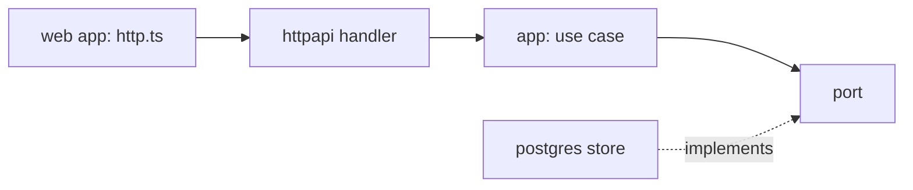

import { Steps, Aside } from '@astrojs/starlight/components';

**What you'll learn:** the six places a new endpoint touches, in order, using Mail's `POST /api/mail/labels` as a worked example.

## The path of a request



## Steps

<Steps>

1. **Describe the endpoint in the contract.**

   The OpenAPI spec comes first. Add the path, its request and response schemas, and the error responses. Reuse shared pieces such as `IdempotencyKey`, `BadRequest` and `Conflict`.

   ```yaml title="contracts/openapi/mail.yaml"
   /api/mail/labels:
     post:
       tags: [labels]
       operationId: createLabel
       summary: Create a user label. Nested names use `/` (`Work/ClientA`), or pass `parentId`.
       parameters:
         - $ref: '#/components/parameters/IdempotencyKey'
       requestBody:
         required: true
         content:
           application/json:
             schema:
               $ref: '#/components/schemas/LabelInput'
       responses:
         '201':
           description: Created.
           content:
             application/json:
               schema:
                 $ref: '#/components/schemas/Label'
         '400':
           $ref: '#/components/responses/BadRequest'
         '401':
           $ref: '#/components/responses/Unauthorized'
         '409':
           $ref: '#/components/responses/Conflict'
   ```

   New error codes go into the `ErrorCode` enum of the same spec.

2. **Generate the TypeScript types and lint the spec.**

   ```sh
   npm run generate -w @suitehive/contracts
   npm run lint -w @suitehive/contracts
   ```

   This rewrites `contracts/ts/src/mail.ts`. Go code is not generated from OpenAPI; you write the handler by hand in the next step.

3. **Add the route and the handler.**

   Mail's routes are registered in one place. Routes inside the group already get authentication, the tenant and idempotency middleware.

   ```go title="mail/internal/webmail/adapters/httpapi/server.go"
   r.Group(func(r chi.Router) {
   	r.Use(h.authn, httpx.Tenant)
   	// ...
   	r.Get("/labels", h.listLabels)
   	r.Post("/labels", h.createLabel)
   ```

   The handler only decodes, calls one use case and writes the result:

   ```go title="mail/internal/webmail/adapters/httpapi/server.go"
   func (h *Handlers) createLabel(w http.ResponseWriter, r *http.Request) {
   	in, err := decode[labelInput](r)
   	if err != nil {
   		fail(w, r, err)
   		return
   	}
   	l, err := h.Labels.Create(r.Context(), app.LabelInput{Name: in.Name, ParentID: in.ParentID, Color: in.Color, Hidden: in.Hidden})
   	if err != nil {
   		fail(w, r, err)
   		return
   	}
   	writeJSON(w, http.StatusCreated, l)
   }
   ```

   `fail` turns kernel errors into problem+json with the right status and code.

4. **Write the use case.**

   The use case validates the rules and talks to storage only through ports (`uc.d.Reads`, `uc.d.Labels`), declared in `app/ports.go`.

   ```go title="mail/internal/webmail/app/labels.go"
   func (uc *Labels) Create(ctx context.Context, in LabelInput) (Label, error) {
   	c, err := resolveCaller(ctx, uc.d.Reads)
   	if err != nil {
   		return Label{}, err
   	}
   	name := strings.TrimSpace(in.Name)
   	if name == "" || len(name) > mbdomain.MaxLabelNameBytes {
   		return Label{}, invalid("name", "1 to 225 characters")
   	}
   	// ...
   	l, err := uc.d.Labels.CreateLabel(ctx, c.Mailbox.ID, name, parent, hex, in.Hidden)
   	if err != nil {
   		return Label{}, mapLabelErr(err)
   	}
   	return labelView(l), nil
   }
   ```

   If the use case needs a new storage method, add it to the port interface in `app/ports.go`, then implement it in the Postgres adapter.

5. **Test it over HTTP.**

   Mail's API tests call the real router with a test principal and check status codes and error codes:

   ```go title="mail/internal/webmail/webmail_test.go"
   r = f.do("priya", "POST", "/api/mail/labels", map[string]any{"name": "Projects", "color": "sky"})
   f.expect(r, 201, "")
   var l app.Label
   r.json(t, &l)
   f.expect(f.do("priya", "POST", "/api/mail/labels", map[string]any{"name": "Projects"}), 409, "mail.label.name_taken")
   ```

   ```sh
   go test ./mail/internal/webmail/ -run TestLabels -count=1
   ```

6. **Call it from the web app.**

   Add the method to the API interface, then implement it twice: once for live mode, once for mock mode (`src/shared/api/mock.ts`).

   ```ts title="mail/web/src/shared/api/ports.ts"
   export interface LabelsApi {
     list(): Promise<Label[]>;
     create(input: LabelInput): Promise<Label>;
     // ...
   }
   ```

   ```ts title="mail/web/src/shared/api/http.ts"
   async create(input) {
     const { data, error, response } = await client.POST('/api/mail/labels', { body: input, headers: { 'Idempotency-Key': crypto.randomUUID() } });
     if (!data) fail(error, response);
     return data;
   },
   ```

   Components use it through a TanStack Query hook:

   ```ts title="mail/web/src/features/labels/use-labels.ts"
   const create = useMutation({
     mutationFn: (input: LabelInput) => api.labels.create(input),
     onSuccess: (label) => qc.setQueryData<Label[]>(key, (list) => [...(list ?? []), label]),
     onSettled: settle,
   });
   ```

   Run `npm run typecheck -w mail/web`. The typed client fails to compile if the path or body does not match the spec.

</Steps>

<Aside type="tip" title="Other services">
The same steps apply to Calendar (`contracts/openapi/calendar.yaml`, handlers in `calendar/internal/<module>/adapters/http/`) and Auth (`contracts/openapi/auth.yaml`, for example `auth/internal/directory/adapters/http/http.go`).
</Aside>

## Next steps

- [Write a test](/docs/developers/recipes/tests/)
- [API reference](/docs/developers/api-reference/)
- [Layering inside a service](/docs/developers/concepts/layering/)
