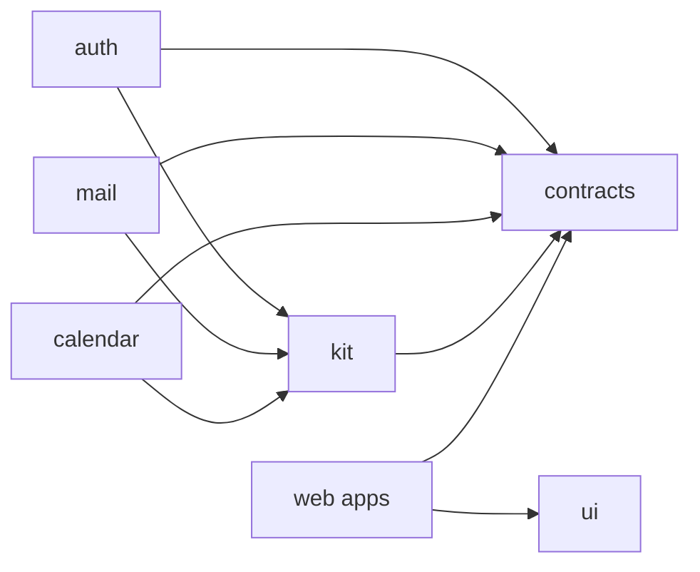

import { Aside } from '@astrojs/starlight/components';

**What you'll learn:** what lives in each repository and which repositories may depend on which.

## The repositories

All repositories are under [github.com/Suitehive](https://github.com/Suitehive). They are private for now.

| Repository | What it owns | Key folders |
|---|---|---|
| [architecture](https://github.com/Suitehive/architecture) | The design documents and the workspace root (`go.work`, root `package.json`) | `docs/design/00` to `10`, `FOUNDATIONS.md`, `PROGRESS.md` |
| [kit](https://github.com/Suitehive/kit) | Shared Go library: mechanisms only, never business rules | `db`, `outbox`, `inbox`, `events`, `authn`, `authz`, `httpx`, `jobs`, `crypto`, `testkit` |
| [contracts](https://github.com/Suitehive/contracts) | The shapes services agree on: REST (OpenAPI), RPC and events (protobuf), generated Go and TypeScript | `openapi/`, `proto/suitehive/`, `gen/go/`, `events/`, `ts/` |
| [ui](https://github.com/Suitehive/ui) | Shared React packages used by every web app | `packages/tokens`, `packages/ui`, `packages/shell`, `packages/auth-client`, `packages/realtime`, `packages/pdf-viewer` |
| [auth](https://github.com/Suitehive/auth) | Auth service: orgs, users, groups, domains, sessions, 2-step, OIDC provider, app passwords, audit; plus the sign-in, account and admin web app | `cmd/auth`, `internal/`, `migrations/`, `web/`, `test/` |
| [mail](https://github.com/Suitehive/mail) | Mail service: SMTP in and out, IMAP, REST API, threads, labels, search, filters, DKIM; plus the Mail web app | `cmd/mail`, `internal/`, `migrations/`, `web/`, `test/` |
| [calendar](https://github.com/Suitehive/calendar) | Calendar service: calendars, events, recurrence, invitations, free/busy, rooms, reminders, CalDAV; plus the Calendar web app | `cmd/calendar`, `internal/`, `migrations/`, `web/`, `test/` |
| [deploy](https://github.com/Suitehive/deploy) | Local development infrastructure. A Helm chart and gateway configuration are planned. | `dev/docker-compose.yml` |
| [suitehive](https://github.com/Suitehive/suitehive) | The product README, the installer (`install.sh`, `install.ps1`), the `suitehive` CLI and the production compose and Caddy templates | `bin/suitehive`, `templates/` |
| [website](https://github.com/Suitehive/website) | This website and its docs | `src/content/docs/docs/` |

## Who may depend on whom

- A service imports only `kit` and `contracts`. Mail never imports Auth's code; it uses Auth's RPC and events, defined in `contracts`.
- `kit` depends on `contracts` only for the event envelope.
- The web apps (`auth/web`, `mail/web`, `calendar/web`) use the `ui` packages and the TypeScript clients from `contracts/ts` (`@suitehive/contracts`).

## Inside a service repository

The three service repositories share one layout:

| Path | Contents |
|---|---|
| `cmd/<service>/` | `main.go`: reads settings, connects to Postgres and NATS, wires every module, starts the HTTP server and workers |
| `internal/<module>/` | One folder per capability (for example `mail/internal/inbound`, `auth/internal/directory`), usually with `domain/`, `app/`, `adapters/`, `api/` and `module.go`. See [Layering](/docs/developers/concepts/layering/) |
| `migrations/` | Numbered, forward-only SQL files embedded in the binary |
| `web/` | The React web app (Vite, TanStack Router and Query, Tailwind) |
| `test/` | Larger test suites (end-to-end, security, protocol, corpus) |
| `README.md`, `RUN.md`, `ARCHITECTURE.md` | Overview, how to run it locally, and the current status of each module |

<Aside type="tip">
Each service's `ARCHITECTURE.md` lists every package with a short description and its status. It is the fastest way to find code you have not seen before.
</Aside>

## Next steps

- [How Suitehive fits together](/docs/developers/how-it-fits/)
- [Coding principles](/docs/developers/coding-principles/)
- [Architecture: repositories](/docs/architecture/repositories/)
