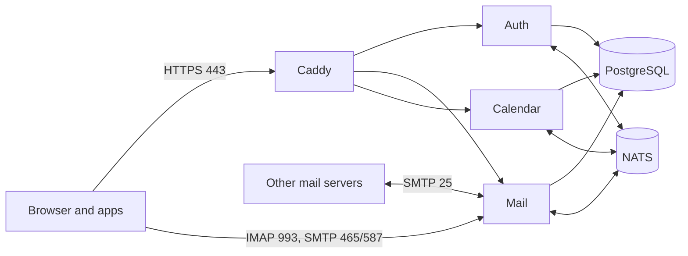

import { Aside, CardGrid, LinkCard } from '@astrojs/starlight/components';

**What you'll learn:** what Suitehive does, what runs today, and where to start.

Suitehive gives your team Mail, Calendar and one shared sign-in on your own domain and your own server.
You run it with Docker Compose on a single machine. Your mail, calendars and accounts stay in your database
and on your disk.

<Aside type="caution" title="Early development">
Suitehive is not production-ready. Container images are not published yet, so the installer needs
`--build` (build from source) or `--dry-run` (write the config, start nothing) until the first release.
Expect breaking changes to configuration, APIs and data until v1. Don't use it for production mail yet.
</Aside>

## What's included

| App | What it does |
|---|---|
| Mail | Web app with threads, labels, search, filters and a vacation responder. Receives and sends Internet mail (SMTP), and works with desktop and phone mail apps over IMAP and SMTP submission. |
| Calendar | Day, week, month, schedule and year views, recurring events, invitations and RSVPs over email, find a time, rooms, sharing and CalDAV sync. |
| Auth | One account for every app: passwords, 2-step verification (authenticator app or passkey), app passwords for mail and calendar apps, and an OpenID Connect provider. |
| Admin | Users, groups, domains, roles, security policies and an audit log in one console. |

Contacts, Drive and Docs are planned for later. See the [roadmap](/docs/roadmap/).

## How it fits together

Caddy is the public entry point and gets TLS certificates automatically. It routes `/login`, `/account`,
`/admin` to Auth, `/mail` to Mail, and `/calendar` and `/dav` to Calendar. Each app has its own database.

## Standards you can rely on

- IMAP and SMTP for mail apps such as Thunderbird and Apple Mail.
- CalDAV for calendar apps.
- iCalendar email (iMIP) for invitations, so they work with people on other providers.
- OpenID Connect for sign-in. Registering your own apps for "Sign in with Suitehive" is planned.

## License

Suitehive is licensed under the [GNU Affero General Public License v3.0](https://www.gnu.org/licenses/agpl-3.0.html) (AGPL-3.0). You can use, self-host, modify and share it freely. If you run a modified version as a service for others, you must publish your changes under the same license.

## Next steps

<CardGrid>
  <LinkCard title="Quick start" href="/docs/getting-started/quick-start/" description="Install on a server or try it on your laptop." />
  <LinkCard title="Requirements" href="/docs/getting-started/requirements/" description="What your server needs, with measured sizing." />
</CardGrid>
