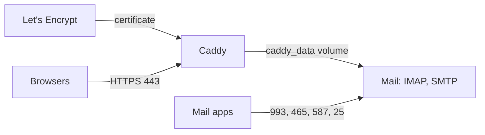

import { Steps, Aside } from '@astrojs/starlight/components';

**What you'll learn:** how certificates are issued and renewed, what Mail uses for IMAP and SMTP, and how to put Suitehive behind your own TLS proxy.

## How it works

Caddy is the public entry point. When `SH_SITE_ADDRESS` in `.env` is a hostname (the default: your `SH_HOSTNAME`), Caddy gets a certificate for it from Let's Encrypt (or ZeroSSL) and renews it on its own. `SH_TLS_EMAIL` is the ACME account email for expiry notices.



Certificates are stored in the `caddy_data` Docker volume. Mail mounts that volume read-only and uses the same certificate for IMAPS (993), SMTP submission (465, 587) and STARTTLS on the MX (25). It reloads the certificate when Caddy renews it. Until the certificate exists, Mail uses a self-signed one.

## Requirements for issuance

<Steps>
1. An A (and AAAA, if you have IPv6) record for your hostname points at the server. Check with `suitehive dns --check`.
2. Ports 80 and 443 are reachable from the internet. Caddy uses them to prove it controls the hostname.
3. `SH_HOSTNAME` is a public name. Names ending in `.local`, `.localhost`, `.test`, `.example` or `.invalid` can't get certificates; the installer warns about them.
</Steps>

If issuance fails, Caddy retries on its own. See what it reports:

```sh
suitehive logs caddy
```

## Headers Caddy adds

The `Caddyfile` sets `Strict-Transport-Security` (one year, including subdomains), `X-Content-Type-Options: nosniff`, and defaults for `Referrer-Policy`, `X-Frame-Options: SAMEORIGIN` and `Permissions-Policy` when an app doesn't set its own. It removes the `Server` header and compresses responses. Each app sets its own `Content-Security-Policy`.

<Aside type="caution" title="HSTS applies to subdomains">
Because of `includeSubDomains`, browsers that visit Suitehive will insist on HTTPS for every subdomain of your hostname for a year.
</Aside>

## Behind another TLS proxy

If a load balancer or reverse proxy in front of Suitehive already terminates TLS:

<Steps>
1. In `.env`, set Caddy to plain HTTP and keep the public URL on HTTPS:

   ```sh title=".env"
   SH_SITE_ADDRESS=:80
   SH_PUBLIC_URL=https://suite.example.com
   ```

2. Forward HTTPS traffic from your proxy to the server's port 80 (or `SH_HTTP_PORT`), keeping the original `Host` header.
3. Apply it: `cd /opt/suitehive && docker compose up -d`.
</Steps>

Two things change in this setup:

- Caddy no longer has a certificate, so Mail falls back to a self-signed one for IMAP and SMTP. Mail apps will warn about it.
- Auth trusts `X-Forwarded-For` only from loopback and private address ranges. If your proxy connects from a public address, add it to `SH_TRUSTED_PROXIES` (this needs a `docker-compose.yml` edit, see [Configuration](/docs/self-hosting/configuration/)).

<Aside type="danger" title="Don't serve sign-in over plain HTTP">
Auth's session cookies use the `__Host-` prefix and the `Secure` flag, so browsers only send them over HTTPS. Users must reach Suitehive over HTTPS. `SH_DEV_INSECURE_COOKIES=true` removes this protection and is meant for `localhost` only.
</Aside>

## Local trial

`install --local` sets `SH_SITE_ADDRESS=:80` and serves `http://localhost:8080` without TLS. IMAP and SMTP use a self-signed certificate.

## Next steps

- [Smarthost relay](/docs/self-hosting/smarthost/)
- [Troubleshooting](/docs/self-hosting/troubleshooting/)
