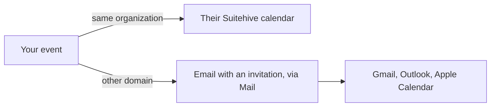

import { Steps, Aside } from '@astrojs/starlight/components';

**What you'll learn:** how to invite guests, how invitations reach people on other providers, and how to reply.

## Invite guests

<Steps>

1. Open the event in the editor and go to the **Guests** tab (or use **Add guests** in quick create).

2. Type names or email addresses. People in your organization are suggested as you type. Addresses outside it
   are marked **external**. You can paste many addresses at once.

3. Optional: open a guest's menu to mark them as an **Optional attendee** or **Remove guest**.

4. Under **Guests can**, choose whether guests may **Modify event**, **Invite others** and **See guest list**.

5. Save. Calendar sends the invitations.

</Steps>

The guest list shows each person's answer: **Going**, **Maybe**, **Not going**, **Awaiting reply** or
**Delegated**, and marks the organizer.

## How invitations are delivered

- **Guests in your organization** get the event in their Suitehive calendar right away, marked as waiting for a reply.
- **Guests elsewhere** get an email with a standard iCalendar invitation (iMIP), so it works with Gmail,
  Outlook, Apple Calendar and others. Their replies come back by email and update your guest list.

When you change or delete an event, Calendar asks **Send update to guests?** Updates and cancellations use the
same paths.

<Aside type="note" title="Known issue">
Invitation emails and replies that come from addresses on your own domain (for example, sent from a desktop
mail app) can be rejected as unverified today. Inside your organization, invite and answer in Calendar or in
Mail's invitation card, which don't depend on email.
</Aside>

## Answer an invitation

You can reply in three places:

- **In Calendar.** Open the event and choose **Yes**, **Maybe** or **No**. Or right-click it and use **RSVP**.
- **In Mail.** Invitation emails show a card with the title, time, organizer and **Going?** with **Yes**,
  **Maybe** and **No**. A canceled event shows **Canceled**.
- **In a CalDAV app** connected to your account. See [Connecting apps](/docs/user-guide/connecting-apps/).

Events you haven't answered look outlined in the grid. Events you declined are hidden unless you turn on
**Settings → General → Show declined events**.

For a repeating event, you choose whether your answer is for **This event** or **All events**.

## Email the guests

Open an event and select **Email guests**, or right-click it and choose **Email guests**. Mail opens a new
message addressed to everyone on the guest list.

## Next steps

- [Find a time and rooms](/docs/user-guide/calendar/find-a-time-and-rooms/)
- [Sharing](/docs/user-guide/calendar/sharing/)
