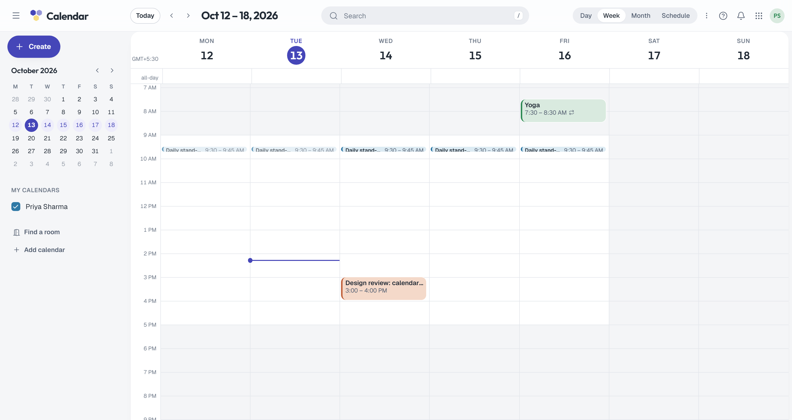

import { Aside } from '@astrojs/starlight/components';

**What you'll learn:** how Calendar is laid out, how to switch views, and where the settings are.

Open Calendar at `https://suite.example.com/calendar` (or `http://localhost:8080/calendar` in local mode).

## Layout

- **Header.** **Today**, previous and next, the date range, search, and the view switcher.
- **Sidebar.** **Create** (or press `c`), a mini month (select a date to jump to it), **My calendars**, **Other calendars**
  and **Rooms**, each with a color and a checkbox to show or hide it. Below them are **Find a room** and
  **Add calendar**.
- **Grid.** Your events. Hours outside your working hours are shaded. A line marks the current time.

## Views

| View | Key | Shows |
|---|---|---|
| Day | `d` | One day, by the hour |
| 4-day | `x` | Four days, by the hour |
| Week | `w` | One week, by the hour, with an all-day row |
| Month | `m` | Six weeks as a grid of days |
| Schedule | `a` | A scrolling list of upcoming events, grouped by day |
| Year | `y` | Twelve small months with dots on busy days |

Press `t` to jump to today, `j` or `k` to move to the next or previous period, and `g` to go to a date.
The view, date and visible calendars are in the URL, for example `/calendar/week/2026-10-12`, so you can
bookmark or share a view.

## How events look

| State | Look |
|---|---|
| Accepted | Solid color with a colored left edge |
| Waiting for your reply | Outlined and lighter |
| Maybe | Striped |
| Declined | Hidden, unless you turn on **Show declined events** (then struck through and faded) |
| Past | Faded |

Events in a different time zone from yours show a small globe icon. Their details show both times.

## Calendars

You have a primary calendar. Select **Add calendar** to **Create new calendar** (name, color, time zone) or
**Import from .ics**. Calendars shared with you appear under **Other calendars**. A lock icon means you can
only read that calendar.

Right-click a calendar in the sidebar for **Show only this**, **Hide**, **Color**, **Settings and sharing**,
**Export**, and **Delete** or **Unsubscribe**.

## Settings

Open the command palette (`Ctrl+K`) and choose **Calendar settings**, or go to `/calendar/settings`.
For one calendar, right-click it in the sidebar (or use its menu) and choose **Settings and sharing**.

| Tab | What you set |
|---|---|
| General | Time zone, secondary time zone, week start, default view, default event length, show weekends, show declined events, keyboard shortcuts, desktop notifications, working hours |
| My calendars | Name, color, sharing, private iCal address, export, delete |
| Import | Import an `.ics` file |
| Calendar apps | Your CalDAV address and a link to create an app password |

<Aside type="note" title="Time zones">
Calendar shows times in the time zone from your settings, not silently in your browser's. All-day events stay
on the same date in every time zone, and days with a daylight saving change show the skipped or repeated hour.
</Aside>

## Next steps

- [Create and edit events](/docs/user-guide/calendar/events/)
- [Invitations and RSVP](/docs/user-guide/calendar/invitations/)
- [Keyboard shortcuts](/docs/user-guide/calendar/shortcuts/)
