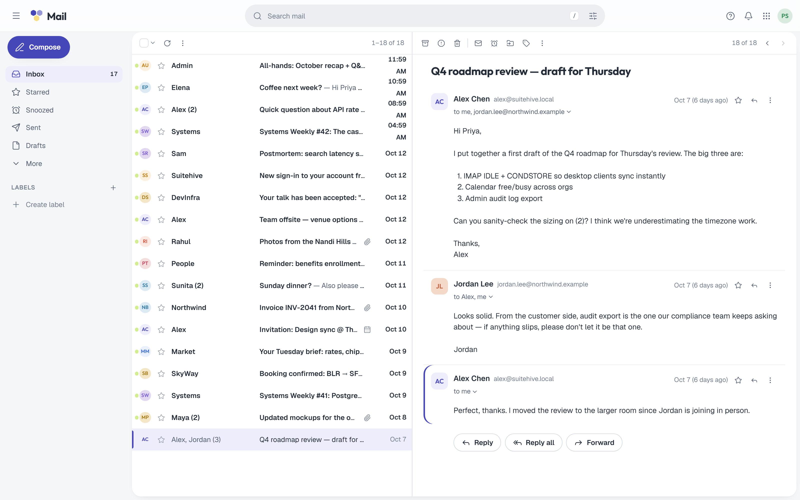

import { Aside } from '@astrojs/starlight/components';

**What you'll learn:** how the Mail web app is laid out, where to find things, and what is still being built.

Open Mail at `https://suite.example.com/mail` (or `http://localhost:8080/mail` in local mode). Signing in once
also signs you in to Calendar and your account pages.

## Layout

- **Sidebar.** Compose button, folders, and your labels with unread counts. Collapse it with `[` or `Ctrl+B`
  (`⌘B` on a Mac).
- **Conversation list.** One row per conversation (thread): sender, subject, snippet, labels, and the time.
- **Reading pane.** The open conversation. You can put it right of the list, below it, or turn it off in
  **Settings → General → Reading pane**. Below needs a window at least 1024 px wide, right needs 1280 px.
- **Top bar.** Search, the app switcher (Mail, Calendar, Admin) and your account menu.

## Folders

| Folder | What's in it |
|---|---|
| Inbox | New mail that hasn't been archived |
| Starred | Conversations you starred |
| Sent | Mail you sent |
| Drafts | Unsent messages; drafts save automatically |
| Important | Conversations marked important |
| All mail | Everything except Spam and Trash |
| Spam | Mail flagged as spam; open it and select **Not spam** to move it back |
| Trash | Deleted conversations. Use **Empty now** to delete them for good |

## Settings

Open the command palette (`Ctrl+K`, or `⌘K` on a Mac) and choose **Mail settings**, or go to `/mail/settings`. The tabs are:

| Tab | What you set |
|---|---|
| General | Reading pane, density, when to mark as read, undo send window, reading font, images, keyboard shortcuts, inbox categories, swipe actions |
| Labels | Your labels and the system labels |
| Filters | Rules for incoming mail |
| Forwarding | Forwarding addresses and automatic forwarding |
| Vacation responder | Automatic replies while you're away |
| Signatures | Your signature for new mail and replies |
| Mail apps | Server names and ports for desktop and phone apps |

## Images and privacy

Remote images in email are blocked by default, so senders can't tell when you open a message. A banner says
**Images hidden**. Select **Show images** for this message or **Always show from sender**. To change the
default, go to **Settings → General → Images**.

## Not available yet

<Aside type="note" title="Still being built">
- **Snooze** and **Mute** appear in menus but the server doesn't support them yet. Using them shows
  "isn't available on this server yet".
- Large attachment uploads (over 10 MB) are not resumable yet.
- A Contacts app is planned. Address suggestions come from your organization's directory and people you've emailed recently.
</Aside>

## Next steps

- [Inbox and labels](/docs/user-guide/mail/inbox-and-labels/)
- [Compose and send](/docs/user-guide/mail/compose/)
- [Keyboard shortcuts](/docs/user-guide/mail/shortcuts/)
